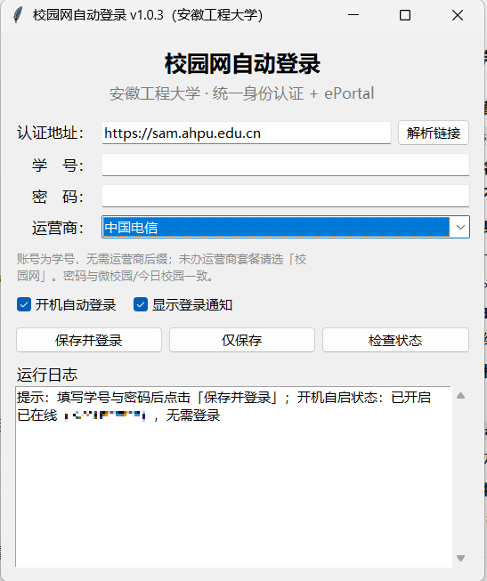

# 校园网自动登录工具

基于 **锐捷 ePortal 5.x + CAS 统一身份认证** 的校园网自动登录工具：图形界面配置、
系统托盘常驻、开机自启、断线自动重连。**不限于安徽工程大学**——同为这套认证体系的
学校，换上自己学校的认证地址多半也能用（适配说明见[适用环境](#适用环境)）。

> 许可证 **GNU GPL-3.0**（全文见 [LICENSE](LICENSE)，SPDX: `GPL-3.0-or-later`）：任何人可
> 自由使用、修改与再分发，但**分发（含打包 exe）时必须以同一许可开源源码**；软件按
> "原样"提供，不附带任何担保。完整免责声明见文末。

| 主窗口 | 托盘右键菜单 |
|---|---|
|  |  |

## 功能特性

- **图形界面 + 托盘常驻**：认证地址、学号、密码、运营商均可配置；图标颜色指示
  🟢 在线 / ⚪ 离线 / 🔴 失败，右键菜单含立即登录、检查状态、清空日志
- **认证链接一键解析**：从浏览器复制来的完整 ePortal 链接（带 `wlanuserip` / `nasip` /
  `sessionId` 等一次性参数）整段粘进认证地址框，自动截成 `https://sam.ahpu.edu.cn`
- **密码加密存储**：Windows DPAPI 密文（仅当前用户 + 本机可解）；日志自动脱敏，
  学号/票据/会话号/MAC 不落明文，超 1 MB 轮转，托盘一键清空
- **断线自动重连**：每 60 秒检测在线，掉线按 1/2/4/8/15 分钟退避重连；密码错误这类
  「重试也没用」的失败会**暂停重连**并只提示一次，避免把统一身份认证账号刷到锁定
- **DNS 被改坏也能登录**：加速器/去广告类软件把网卡 DNS 从"自动获取"改成手动后，
  域名解析会整体失效（浏览器打不开认证页就是这个原因）。域名解析失败时本工具自动
  改连上次成功解析到的 IP（Host/证书校验仍按域名，不降级安全性）；巡检发现
  "在校园网内却解析不了"时托盘告警，右键菜单「修复 DNS」一键把网卡 DNS 恢复成
  自动获取并自动重登
- **开机自启**：注册表 Run 项 + 静默模式（`--login`）；程序目录移动后自动校正启动项
- **配置写入安全**：临时文件 + 原子替换，断电不留半截 JSON；单实例运行，不会出现两个托盘

更多能力（通知策略、证书校验、失败分类）与实现细节见下方 [文档索引](#文档)。

## 快速开始

```bash
# 安装依赖（仅需一次）
pip install -r requirements.txt

# 启动（图形界面 + 托盘）
python 校园网自动登录.py

# 静默模式（开机自启使用）
python 校园网自动登录.py --login

# 只查在线状态，不启动界面
python 校园网自动登录.py --status
```

> **别用会关掉的终端窗口跑它**：关终端时 Windows 会连同托盘图标一起退出程序。
> 日常使用请用 `pythonw`，或直接装打包版（exe 本身没有控制台）。

### 首次配置

1. 运行程序 → 配置窗口
2. 认证地址保持默认 `https://sam.ahpu.edu.cn`
   （浏览器复制来的完整认证链接可以直接粘进地址框，点「解析链接」或直接粘贴，
   自动截成 origin——见 [docs/config-and-privacy.md](docs/config-and-privacy.md)）
3. 填 **学号** 和 **统一身份认证密码**（与微校园、今日校园同一套密码）
4. 选择运营商出口：未办套餐选「校园网」；办了宽带的选对应运营商
5. 按需勾选「开机自动登录」「显示登录通知」→ 点击「保存并登录」

> 学号**不需要**任何 `@dx` / `@lt` 之类的后缀，填纯学号即可。

### 开机自启

配置窗口或托盘菜单勾选「开机自动登录」即可；原理是注册表 `HKCU\…\Run` 项，
登录 Windows 后以静默模式自动认证，取消勾选即删除。

## 分发给同学

1. 打包 + 签名的完整流程见 [docs/build.md](docs/build.md)，
   产物 `installer\output\校园网自动认证系统_安装包_1.0.4.exe`
2. **不要附带 `config.json`**——里面是你的学号和你机器加密的密码
3. 同学双击安装 → 填自己的学号密码 → 勾「开机自动登录」→ 保存并登录

## 常见问题

- **认证地址怎么填**：只填「协议 + 主机 + 端口」（如 `https://sam.ahpu.edu.cn`）；
  浏览器复制来的整串链接直接粘贴即可自动截断，非法地址保存时会被拦下并提示原因
- **托盘图标不显示**：未装 pystray，执行 `pip install pystray pillow`
- **提示缺少 cryptography**：执行 `pip install cryptography`（密码加密必需）
- **开机没自动登录**：托盘菜单确认已勾选；任务管理器 → 启动 中查看是否被禁用
- **登录失败**：打开 `login.log` 对照 [docs/troubleshooting.md](docs/troubleshooting.md) 的报错表

更多排错手段（probe 调试脚本 / autodiag 自动诊断 / selftest）见
[docs/troubleshooting.md](docs/troubleshooting.md)。

## 适用环境

- 安徽工程大学（本部 / 国际工程师学院校区）有线网、`AHPU`、`ahpu-stu` 无线网
- Windows 10 / 11（桌面版，支持系统托盘）；Python 3.9+（CI 覆盖 3.9 / 3.12）
- 认证体系：锐捷 ePortal 5.x + CAS 统一身份认证

**其他学校能用吗？** 或许能。认证流程是 ePortal 5.x + CAS 的通用流程：认证地址、
出口名称在配置里就能改（多数学校到这一步即可）；个别写死本校信息的常量在源码里有
明确位置，按需一行替换。分级适配步骤见
[docs/protocol.md 的「其他学校适配」](docs/protocol.md#其他学校适配)。

## 文档

| 文档 | 内容 |
|---|---|
| [docs/protocol.md](docs/protocol.md) | 认证协议逐步拆解（实测验证）、每 60 秒轮询的请求特征与修改方法、启动耗时 |
| [docs/config-and-privacy.md](docs/config-and-privacy.md) | config.json 全字段说明、DPAPI 加密边界、日志脱敏与轮转 |
| [docs/troubleshooting.md](docs/troubleshooting.md) | 调试脚本、自动诊断、常见报错对照表、完整 FAQ |
| [docs/build.md](docs/build.md) | 三种打包方案、Inno Setup 安装包、代码签名与 SmartScreen、杀毒误报 |
| [docs/development.md](docs/development.md) | 测试（101 用例）、版本号同步清单、GitHub 推送与 Release 流程 |

## 免责声明

> **本项目仅供学习与研究参考，与安徽工程大学及其网络管理部门无关，
> 未经授权、未获认可。**
>
> - 程序做的是「代替你手动点登录页」这件事，使用的仍是**你自己的账号和密码**，
>   不会绕过任何认证、不会共享账号、不会修改计费或出口策略
> - 请遵守学校《校园网用户守则》与相关管理规定；因使用本工具（含自动重连频率、
>   账号被风控锁定等）产生的一切后果由使用者自行承担
> - 统一身份认证有失败次数限制，程序已做失败分类与退避（认证类失败会暂停重连），
>   但**请不要把重试间隔改小**，也不要多台设备同时刷同一账号
> - 软件按「原样」提供，不附带任何明示或暗示的担保；作者不对数据丢失、
>   账号异常、网络中断等任何直接或间接损失负责
> - 再分发或修改本程序须遵循 **GPL-3.0**：保留许可与版权声明，以同一许可提供源码
>   （含自行打包的 exe）；分发时也请一并去掉 config.json、login.log 等个人数据

## 许可证与贡献

- 许可证：**GNU GPL-3.0**（全文见 [LICENSE](LICENSE)，SPDX: `GPL-3.0-or-later`）——
  任何人可自由使用、学习、修改与再分发，**商用也允许**；但再分发（含修改版与
  自行打包的 exe）时必须以同一许可提供源码，保留许可与版权声明；闭源二次分发不在许可范围内
- 发现问题欢迎提 Issue；涉及安全（密码/日志泄露一类）请走私密渠道，见 [SECURITY.md](SECURITY.md)
- 提交代码前请先跑 `python -m pytest -q`，并保持 `git ls-files` 里没有 `config.json`、`login.log` 之类个人数据
